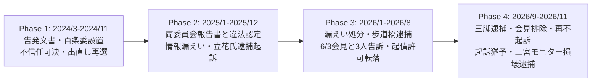

# 兵庫県政問題 統合時系列年表＆周辺事件整理ノート（2024年3月〜2026年11月）

- **作成日**: 2026-11-27
- **対象期間**: 2024年3月12日（告発文書送付）〜2026年11月27日現在
- **目的**: 兵庫県政の本丸（告発文書・調査・議会・財政・知事会見）と、周辺で発生した刑事事件・司法手続・抗議現場の逮捕事案等を、時系列の全体像として1つのノートに整理すること。
- **関連リポジトリ資料**:
  - 原稿アーカイブ棚卸し: [202609-11_inventory_and_evolution.md](./202609-11_inventory_and_evolution.md)
  - 2026年公式会見録分析: [2026_rhetoric_shift.md](../kaiken/analysis/2026_rhetoric_shift.md)
  - 外部書き起こし突合メモ: [seijou-ni-modosu-kai README](../kaiken/external/seijou-ni-modosu-kai/README.md)

> [!IMPORTANT]
> 本ノートは `.agents/rules/hyogo-radio-core.md` および `.agents/rules/hyogo-radio-review.md` に準拠し、情報の性質を区別して記載しています。
> - **`[事実]`**: 日付、公的機関の決定、司法処分、議事録・公式文書の原文
> - **`[公式説明]`**: 知事・県当局が公式に述べている説明・見解
> - **`[外部指摘]`**: 百条委員会、第三者委員会、検察審査会、総務省、記者クラブ等の指摘・認定
> - **`[報道]`**: 報道機関の報道および公開されているSNS投稿・会見動画等に基づく情報
> - **`[未確認・留保]`**: 会見質疑等での言及はあるが主要報道・公的詳細が未確認のもの
>
> また、一般市民の現行犯逮捕事案等については個人情報保護・私人攻撃防止の観点から、報道に記載された範囲の属性表記にとどめ、一般人の実名・住所等の特定につながる記載は避けています。

---

## 1. 全体の見取り図（4つのフェーズと4つの並行レーン）

2024年3月の告発文書送付に始まった兵庫県政の混乱は、2024年11月の出直し知事選を経て、2025年以降は**「①県政本丸（調査報告書・財政・議会）」「②知事選・周辺議員の動向」「③会見・言論・刑事告訴」「④抗議現場での衝突・逮捕事案」**の4つの流れが同時並行で絡み合う構造へと広がっています。

### 4つの並行レーンの関係

| レーン | 主な軸 | 主な出来事の流れ |
|---|---|---|
| **A. 県政本丸** | 告発文書・行政調査・財政・県議会 | 2024/3告発・5月処分 → 百条委・第三者委で違法認定 → 2026年に入っても県側は「適切」維持 → 8月「起債許可団体」転落・11月用先債報告書 |
| **B. 選挙・周辺政治** | 出直し選・SNS選挙・周辺県議 | 2024/11出直し選（N党・PR会社問題）→ 2025/3「躍動の会」結成 → 2026/10高砂補選・11月尼崎市長選敗北、増山県議の変装デモ潜入 |
| **C. 言論・刑事告訴・司法** | 名誉毀損・侮辱・地公法・公選法 | 竹内元県議へのデマで立花氏逮捕起訴 / 奥谷県議・丸尾県議への言動 / 漏えい不起訴・検審「不起訴相当」 / 6/3会見めぐる市民3人告訴→11/20起訴猶予と会見排除 |
| **D. 街頭・抗議現場の事件** | 県庁・歩道橋・三宮の現場トラブル | 2025/4県庁6階侵入逮捕→有罪 / 2025/6尼崎「私人逮捕」/ 2026/4歩道橋プラカード逮捕→起訴猶予 / 9/2三脚逮捕→不起訴 / 10/7侮辱逮捕 / 11/21三宮モニター逮捕 |

---

## 2. 統合時系列マスター年表（2024年3月〜2026年11月）

> 各行の区分：**[本丸]**＝県政・行政調査・財政／**[政治]**＝選挙・周辺議員／**[司法]**＝刑事告訴・検察・裁判／**[現場]**＝街頭・庁舎での逮捕事案・トラブル

### 2024年：発端〜不信任〜出直し知事選

| 年月日 | 区分 | 出来事（情報階層つき） | 主な位置づけ・リポジトリ内関連 |
|---|---|---|---|
| **2024/03/12** | [本丸] | **`[事実]`** 元西播磨県民局長が知事らの疑惑を記した告発文書を県警・報道機関・議員ら10か所へ送付。 | 一連の問題の発端 |
| **2024/03/20頃** | [本丸] | **`[報道]`** 県側が民間の情報提供等を通じて告発文書を把握。 | 作成者特定調査の起点 |
| **2024/03/25** | [本丸] | **`[事実]`** 片山副知事らが西播磨県民局を訪問し、元局長の公用パソコンを回収。 | 後の私的情報漏えいの起点 |
| **2024/03/27** | [本丸] | **`[事実]`** 県が元局長を解任（総務部付）。知事は定例会見で文書を「嘘八百」「公務員として失格」と発言。部下が県警へ名誉毀損の相談（百条委証言・報道）。 | 2026年11月時点も「嘘八百」未撤回（[20261126.md](../2026-11/20261126.md)） |
| **2024/04/04** | [本丸] | **`[事実]`** 元局長が県の公益通報窓口（内部・外部）へ実名で通報。 | 後に第三者委が公益通報該当と認定 |
| **2024/05/07** | [本丸] | **`[事実]`** 県が元局長に対し停職3か月の懲戒処分を発表（文書作成・配布等を含む）。 | 後の「受け入れた」発言争点の対象 |
| **2024/06/13** | [本丸] | **`[事実]`** 兵庫県議会本会議で百条委員会（文書問題調査特別委員会）設置案を可決（翌14日に初会合、委員長に奥谷謙一県議）。 | 県議会51年ぶりの百条委 |
| **2024/07/07** | [本丸] | **`[事実]`** 証人尋問を控えていた元西播磨県民局長が死亡（`[報道]` 自死と伝えられた）。 | 死因の断定・私的詮索は扱わない |
| **2024/07/12** | [本丸] | **`[事実]`** 片山安孝副知事が辞職意向を表明（7月31日付で退任）。 | [20261027.md](../2026-10/20261027.md) |
| **2024/07/19** | [本丸] | **`[事実]`** 百条委第3回会合でワイン等の音声データについて知事が自身の発言を認める。 | 証人尋問の前段 |
| **2024/09/06** | [本丸] | **`[事実]`** 百条委で斎藤知事（1回目）・片山前副知事への証人尋問を実施。 | 通報者探索・処分経緯を追及 |
| **2024/09/19** | [本丸] | **`[事実]`** 兵庫県議会本会議が斎藤知事に対する不信任決議案を全会一致で可決。 | 全会派一致 |
| **2024/09/30** | [本丸] | **`[事実]`** 斎藤知事が自動失職を選択し、同日出直し知事選への出馬を表明。 | — |
| **2024/10/31** | [政治] | **`[事実]`** 兵庫県知事選挙告示。立花孝志氏（NHK党党首）も立候補し、斎藤氏を支援するいわゆる「2馬力選挙」を公言。 | — |
| **2024/11/03** | [現場] | **`[事実]`** 知事選期間中、立花氏が奥谷謙一県議の自宅兼事務所前で演説（「出てこい奥谷」等）。 | 後の脅迫容疑等の告訴対象（[20260929.md](../2026-09/20260929.md)） |
| **2024/11/17** | [政治] | **`[事実]`** 出直し知事選投開票。斎藤元彦氏が再選。 | — |
| **2024/11/18** | [政治] | **`[事実]`** 百条委委員だった竹内英明県議がSNS中傷等を背景に議員辞職。 | [20261028.md](../2026-10/20261028.md) |
| **2024/11月下旬** | [政治] | **`[報道]`** PR会社「merchu」代表・折田楓氏のnote投稿をきっかけに、公職選挙法違反疑惑が浮上し刑事告発へ。 | 後に不起訴→検審「不起訴相当」 |
| **2024/12月** | [司法] | **`[報道]`** 立花氏が大阪府泉大津市長選の街頭演説等で竹内元県議について発言。 | 後の名誉毀損逮捕容疑の一部 |

### 2025年：両調査報告書・情報漏えい発覚・周辺逮捕

| 年月日 | 区分 | 出来事（情報階層つき） | 主な位置づけ・リポジトリ内関連 |
|---|---|---|---|
| **2025/01/18** | [政治] | **`[事実]`** 竹内英明元県議が死去（1月20日、知事は「大変ショック」「SNSはいい使い方、冷静な使い方を」等の一般論でコメント）。 | [20261028.md](../2026-10/20261028.md) |
| **2025/02〜03** | [政治] | **`[事実]`** 百条委の非公開音声データや真偽不明文書の立花氏側への提供が発覚。兵庫維新の会が増山誠・白井孝明両県議に離党勧告、岸口実県議を除名。 | — |
| **2025/03/04〜05** | [本丸] | **`[事実]`** 県議会百条委が調査報告書を公表（3/4）し、3/5に県議会が了承。同日知事は定例会見で元局長の私的文書に言及（「わいせつな文書」等）。 | [20261028.md](../2026-10/20261028.md) |
| **2025/03/10** | [政治] | **`[事実]`** 維新を離れた増山・岸口・白井の3県議が県議会新会派「躍動の会」を結成（知事支持姿勢を明確化）。 | [20260920.md](../2026-09/20260920.md)、[20261113.md](../2026-11/20261113.md) |
| **2025/03/19** | [本丸] | **`[外部指摘]`** 県設置の「文書問題に関する第三者調査委員会」が報告書公表。告発は公益通報に該当し、通報者探索・懲戒処分は公益通報者保護法違反（違法・無効）、パワハラ等も認定。 | 知事側は「真摯に受け止める」としつつ「対応は適切」を維持 |
| **2025/04/10** | [現場] | **`[報道]`** 大学生ら2人が拡声器を持ち兵庫県庁2号館6階（知事室フロア）に立ち入り、建造物侵入容疑で現行犯逮捕。 | 詳細は第3部カルテ1（[20260927.md](../2026-09/20260927.md)） |
| **2025/05/27** | [本丸] | **`[外部指摘]`** 県「秘密漏えい疑いに関する第三者委員会」が報告書公表。井ノ本知明元総務部長による私的情報漏えいを認定し、「知事および元副知事の指示のもとに行われた可能性が高い」と指摘。同日、県は井ノ本氏を停職3か月の懲戒処分。 | [20260918.md](../2026-09/20260918.md)、[20260925.md](../2026-09/20260925.md) |
| **2025/06月** | [司法] | **`[報道]`** ①奥谷県議の告訴を受け県警が立花氏を脅迫・名誉毀損・威力業務妨害容疑で書類送検。②竹内氏遺族が立花氏を名誉毀損で刑事告訴（受理）。③上脇博之教授が知事・片山氏・井ノ本氏を地公法違反等で刑事告発。 | 3件の刑事手続が始動 |
| **2025/06/12** | [政治] | **`[事実]`** 兵庫県議会が増山・岸口両県議に対する問責決議案を賛成多数で可決。 | 法的拘束力なし |
| **2025/06/14** | [現場] | **`[報道]`** 尼崎市議選の街頭演説中、N党関係者らがユーチューバー「ドンマッツ」氏を「私人逮捕」名目で拘束し負傷させた事案が発生（9月告訴受理→書類送検）。 | 詳細は第3部カルテ2 |
| **2025/11/09** | [司法] | **`[事実]`** 兵庫県警が立花孝志氏を故・竹内英明元県議に対する名誉毀損（生前・死者への名誉毀損）容疑で逮捕。斎藤知事は同日「コメント控える」と取材対応。 | **★提示URL2**（[毎日新聞](https://mainichi.jp/articles/20251109/k00/00m/010/078000c)） / 詳細は第3部カルテ3 |
| **2025/11/12** | [司法] | **`[事実]`** PR会社公選法違反告発について、神戸地検が斎藤知事・折田氏を嫌疑不十分で不起訴処分。 | — |
| **2025/11/27** | [司法] | **`[事実]`** 2025/4/10の県庁6階立ち入り事件で、神戸地裁が大学生に対し罰金10万円の有罪判決。 | [20260927.md](../2026-09/20260927.md) |
| **2025/11/28** | [司法] | **`[事実]`** 神戸地検が立花氏を名誉毀損罪で起訴（以後、保釈請求却下・準抗告棄却により勾留継続）。 | 報道により11/27〜28と表記差あり |
| **2025/12/24** | [司法] | **`[事実]`** 神戸地検が①奥谷県議告訴につき立花氏を嫌疑不十分で不起訴（奥谷氏側は検審申立て）、②6/14尼崎私人逮捕事案につき立花氏ら3人を暴行等に切り替え起訴猶予処分。 | [20260929.md](../2026-09/20260929.md) |

### 2026年前半（1月〜8月）：司法判断・歩道橋逮捕・6/3会見告訴・起債許可転落

| 年月日 | 区分 | 出来事（情報階層つき） | 主な位置づけ・リポジトリ内関連 |
|---|---|---|---|
| **2026/01/04** | [現場] | **`[報道]`** 四宮神社（神戸市）で知事参拝時に居合わせた子守康範氏が排除されるトラブル発生（1/7定例会見でも質疑：[2026-01-07.md](../kaiken/2026/2026-01-07.md)）。 | [2026-04-28.md](../kaiken/2026/2026-04-28.md) L1199でも言及 |
| **2026/01/07** | [司法] | **`[報道]`** 奥谷県議が立花氏・N党を相手取り1,100万円の損害賠償を求める民事訴訟を神戸地裁に提起。 | — |
| **2026/01/28** | [司法] | **`[事実]`** 丸尾まき県議の民事訴訟で、神戸地裁尼崎支部が立花氏に330万円の賠償命令判決（控訴→自己破産手続で中断→10月大阪高裁再開）。 | [2026-01-28.md](../kaiken/2026/2026-01-28.md)、[2026-02-04.md](../kaiken/2026/2026-02-04.md) |
| **2026/02/13** | [司法] | **`[事実]`** 兵庫県警が井ノ本元総務部長を地方公務員法違反容疑で書類送検。 | 別途県職員1名も書類送検→後に不起訴（[2026-10-22.md](../kaiken/2026/2026-10-22.md) L494） |
| **2026/03/24** | [司法] | **`[報道]`** 子守康範氏の侮辱罪をめぐる正式裁判初公判が神戸地裁で開廷（略式命令科料9,000円に不服申立て。10/28結審・求刑同額、判決は2027/1/15予定）。 | — |
| **2026/03/27** | [司法] | **`[事実]`** 私的情報漏えい事件で神戸地検が斎藤知事・片山元副知事を嫌疑不十分で不起訴、井ノ本元総務部長を起訴猶予処分（4月に上脇教授が検察審査会へ申立て）。 | [20260918.md](../2026-09/20260918.md)、[2026-05-13.md](../kaiken/2026/2026-05-13.md) |
| **2026/04/22** | [現場] | **`[報道]`** 兵庫県庁北側歩道橋での抗議中、知事支持側女性のプラカードを蹴って壊したとして「ドンマッツ」名義で発信する男性（47）が器物損壊容疑で現行犯逮捕。 | **★提示URL3**（[子守氏X投稿](https://x.com/10komori/status/2047934905997508915)）の背景 / 詳細は第3部カルテ4 |
| **2026/04/25〜28** | [現場] | **`[報道]`** 4/22逮捕をめぐる各紙実名報道の問題点を4/25に子守氏がX投稿（URL3）。また神戸女学院理事長私塾をめぐるデマが拡散し、4/28定例会見で質疑（[2026-04-28.md](../kaiken/2026/2026-04-28.md) L1123–1157）。後に同事件は神戸区検が起訴猶予処分。 | デマを拡散した浜田聡元参院議員・増山県議の責任を記者が追及 |
| **2026/05〜06** | [本丸] | **`[事実]`** 5/20・6/3定例会見で知事が元局長の懲戒処分を「結果として受け入れた」趣旨で発言。また5/31明石駅前デモの傷害逮捕が6/3会見質問で言及される（※主要報道未確認のため留保）。 | [2026-06-03.md](../kaiken/2026/2026-06-03.md) L1104 |
| **2026/06/03** | [司法] | **`[事実]`** 定例会見で知事答弁の途中に菅野完氏が「人の死を愚弄するな」「人殺しやないか」と発言（県公式録・動画で該当表現削除注記）。 | [2026-06-03_diff.md](../kaiken/external/seijou-ni-modosu-kai/2026/diff/2026-06-03_diff.md) |
| **2026/06/09〜** | [司法] | **`[報道]`** 知事側が菅野氏およびX上で同趣旨投稿をした中道一政・難波文男両氏を名誉毀損容疑で刑事告訴（6/9生田署受理と報道、6/10会見で知事が言及）。 | 詳細は第3部カルテ5（[20260926.md](../2026-09/20260926.md)〜[20260928.md](../2026-09/20260928.md)） |
| **2026/06/17** | [司法] | **`[事実]`** PR会社公選法違反告発について検察審査会が「不起訴相当」議決。 | 法的判断終結 |
| **2026/06/24** | [司法] | **`[外部指摘]`** 奥谷県議告訴について神戸第2検察審査会が脅迫容疑を「不起訴不当」と議決（7/13公表。名誉毀損・威力業務妨害は「不起訴相当」）。 | [20260929.md](../2026-09/20260929.md) |
| **2026/08月** | [本丸] | **`[事実]`** 実質公債費比率（3年平均）18%超により14年ぶりに「起債許可団体」転落見込みが確定し、8/27に総務省へ公債費負担適正化計画を提出。また用先債の不適切会計処理が判明。同月、本会議場へのスマホ持ち込みで知事が議長から口頭注意。 | [2026_rhetoric_shift.md](../kaiken/analysis/2026_rhetoric_shift.md)、[20260927.md](../2026-09/20260927.md) |

### 2026年後半（9月〜11月）：三脚逮捕・会見排除・再不起訴・起訴猶予・モニター破壊逮捕

| 年月日 | 区分 | 出来事（情報階層つき） | 主な位置づけ・リポジトリ内関連 |
|---|---|---|---|
| **2026/09/02** | [現場] | **`[報道]`** 兵庫県庁前でのデモ活動中、他人のカメラ用三脚を壊したとして神戸市長田区の男性（44・容疑否認）が器物損壊容疑で現行犯逮捕。 | **★提示URL4**（[神戸新聞X](https://x.com/kobeshinbun/status/2095133415293305004)） / 詳細は第3部カルテ6 |
| **2026/09月** | [司法] | **`[報道]`** 名誉毀損容疑で告訴されていた菅野完・中道一政・難波文男氏の3人が書類送検。 | — |
| **2026/09/25** | [司法] | **`[事実]`** ①告訴された市民3人が記者会見。②神戸地検が奥谷県議に対する脅迫容疑について立花氏を再び嫌疑不十分で不起訴（捜査終結）。 | [20260926.md](../2026-09/20260926.md)〜[20260929.md](../2026-09/20260929.md) |
| **2026/10/06〜07** | [司法] | **`[事実]`** 記者クラブが自粛明けの菅野氏の会見復帰を認めたが、前日10/6に県（知事判断）が参加拒否を通告、10/7に入室拒否。記者クラブは「受け入れられない」と声明。 | [202610062.md](../2026-10/202610062.md)、[20261115.md](../2026-11/20261115.md) |
| **2026/10/07** | [現場] | **`[報道]`** 県庁近くの歩道橋で抗議活動参加の女性に対する侮辱・県迷惑防止条例違反容疑で神戸市垂水区の男性（46）を逮捕。 | 詳細は第3部カルテ7 |
| **2026/10/14** | [司法] | **`[外部指摘]`** 私的情報漏えい事件について神戸第2検察審査会が知事・片山氏・井ノ本氏3人全員を「不起訴相当」と議決（10/17公表）。 | — |
| **2026/10/25** | [政治] | **`[事実]`** 県議補選（高砂市）投開票。知事支持を掲げた片山安孝元副知事が落選（島津明香氏当選）。 | [20261027.md](../2026-10/20261027.md)、[20261028.md](../2026-10/20261028.md) |
| **2026/11/04** | [本丸] | **`[事実]`** 定例会見で知事が自分への抗議を「社会通念上許容されるものではない」「自己満足」等と批判しフランスの暴動に言及。一方で支持者ヘイト等には一般論を維持。 | [2026-11-04.md](../kaiken/2026/2026-11-04.md)、[20261107.md](../2026-11/20261107.md)、[202611082.md](../2026-11/202611082.md)、[202611084.md](../2026-11/202611084.md) |
| **2026/11/11** | [本丸] | **`[外部指摘]`** 県財務検証部会が用先債の借換事案に関する検証報告書を提出（井戸前知事の方針指示可能性と地方財政法趣旨に照らした不適切処理を指摘）。 | — |
| **2026/11/13** | [司法] | **`[報道]`** 9/2逮捕の三脚損壊容疑の男性について、神戸区検が嫌疑不十分で不起訴処分。 | 詳細は第3部カルテ6 |
| **2026/11/15** | [政治] | **`[事実]`** ①尼崎市長選で福永活也氏（躍動の会・N党支援）が落選。②同日、西宮市で行われた「増山やめろデモ」に増山誠県議本人が変装して潜入・動画配信。 | [20261117.md](../2026-11/20261117.md)、[20261120.md](../2026-11/20261120.md) |
| **2026/11/17〜18** | [本丸] | **`[事実]`** 再選から2年。11/18定例会見冒頭に異例の抗議批判コメントを挿入。総務省指摘の会計処理には「検証・再発防止」と答える一方、第三者委違法認定には「適切」を維持。 | [2026-11-18.md](../kaiken/2026/2026-11-18.md)、[20261118.md](../2026-11/20261118.md)、[20261121.md](../2026-11/20261121.md) |
| **2026/11/19** | [本丸] | **`[報道]`** 神戸新聞・JX通信社世論調査公表（支持35.6%・不支持48.6%、告発文書問題への県対応に「納得できない」56.9%）。 | [20261124.md](../2026-11/20261124.md) |
| **2026/11/20** | [司法] | **`[事実]`** 神戸地検が菅野完氏ら3人について、名誉毀損から侮辱罪に切り替えて認定した上で「経緯・目的を含む情状全般を考慮し」起訴猶予処分。知事代理人弁護士は検察審査会申立てを検討とコメント。 | [20261123.md](../2026-11/20261123.md) |
| **2026/11/21** | [現場] | **`[報道]`** 神戸市中央区三宮の歩道で、市民団体「兵庫県政を正常に戻す会」の街頭活動用モニターを手で倒し壊したとして、神戸市兵庫区の男（69）を器物損壊容疑で現行犯逮捕（容疑認める／11/24に警察発表の一部表現を修正）。 | **★提示URL1**（[Yahoo!ニュース/神戸新聞NEXT](https://news.yahoo.co.jp/articles/01871dcd0cee75f2c2a75f0765e6d624f6847982)） / 詳細は第3部カルテ8 |
| **2026/11/25** | [司法] | **`[報道]`** 定例会見で起訴猶予後も菅野氏の参加拒否を継続。再犯防止推進計画との整合性を問われても「個人として対応」「円滑な会見運営」と答弁（公式議事録は11/27現在「作成中」）。 | [2026-11-25.md](../kaiken/2026/2026-11-25.md)、[20261126.md](../2026-11/20261126.md) |

---

## 3. 周辺事件・逮捕／司法事案 詳細整理ノート（案件別カルテ）

### カルテ1：兵庫県庁2号館6階（知事室フロア）建造物侵入事件（2025年4月）

- **性質**: 批判側の庁舎内立ち入りに対する現行犯逮捕・起訴・有罪判決
- **発生・逮捕**: **`[報道]`** 2025年4月10日、知事への面会・請願等を掲げ、大阪府などの大学生（当時20）ら複数名が兵庫県庁2号館6階（知事室フロア）へ無断立ち入りし、拡声器で抗議活動を行ったため、通報を受けた警察により建造物侵入容疑で現行犯逮捕（起訴・保釈を経て公判）。
- **司法判断**: **`[事実]`** 2025年11月27日、神戸地裁（入子光臣裁判官）が「拡声器を用いた抗議活動は平穏な請願に当たらず、管理権者の意思に反する立ち入りだった」として**罰金10万円の有罪判決**を言い渡した。
- **論点（既存原稿での扱い）**: [20260927.md](../2026-09/20260927.md) では、中道一政氏（弁護人）の主張を紹介しつつ、「庁舎管理規則違反の有罪事案と同一視はしない」と留保した上で、「批判的な立ち入りは刑事事件化し、支持的な接触（拍手・握手等）は歓迎される温度差」として整理している。

### カルテ2：尼崎市議選街頭での「私人逮捕」拘束トラブル（2025年6月）

- **性質**: 選挙街頭でのユーチューバー「ドンマッツ」氏への拘束・負傷事案
- **発生・告訴**: **`[報道]`** 2025年6月14日、兵庫県尼崎市議選の街頭演説中、NHK党の立花孝志党首らの関与のもと、党関係者らがユーチューバー「ドンマッツ」氏を「私人逮捕」の名目で拘束し、頸椎捻挫等のけがを負わせたとされる。同年9月に逮捕監禁致傷・傷害等の告訴状が受理され書類送検。
- **司法判断**: **`[事実]`** 2025年12月24日、神戸地検が立花氏ら関係者3人を暴行等に切り替えた上で**起訴猶予処分**とした。

### カルテ3：立花孝志氏 逮捕・起訴（故・竹内英明元県議への名誉毀損）（2025年11月〜）

- **提示資料**: **URL2** [毎日新聞 2025/11/9「斎藤元彦兵庫県知事『コメント控える』 立花容疑者逮捕を受け」](https://mainichi.jp/articles/20251109/k00/00m/010/078000c)
- **発生・告訴**: **`[報道]`** 2024年12月の泉大津市長選街頭演説や、2025年1月の竹内英明元県議死去後のSNS・YouTube等で、立花氏が「警察の取り調べを受けているのは多分間違いない」「明日逮捕される予定だった」等の虚偽情報を発信（県警側は明白な虚偽と否定）。遺族（妻）が刑事告訴し、2025年6月受理。
- **逮捕・起訴・勾留**: **`[事実]`**
  - 2025年11月9日、兵庫県警が名誉毀損容疑（生前および死者への名誉毀損）で立花氏を逮捕。
  - 2025年11月28日（27日〜28日報道）、神戸地検が名誉毀損罪で起訴。その後の保釈請求・準抗告は却下され、2026年秋時点でも勾留継続のまま公判手続きが進行中。
- **知事の公式対応・対比**: **`[公式説明]`** 逮捕当日の11月9日、姫路市で取材に応じた斎藤知事は「捜査に関することでもありコメントは差し控える」と述べ、あわせて「誹謗中傷や名誉毀損につながる発信は控えることが大事」との一般論を述べた（[20261028.md](../2026-10/20261028.md)）。

### カルテ4：兵庫県庁北側歩道橋 プラカード器物損壊逮捕（「ドンマッツ」氏事件）（2026年4月）

- **提示資料**: **URL3** [子守康範氏（@10komori）X投稿 2026/4/25 16:05](https://x.com/10komori/status/2047934905997508915)（「【スクープ】実名報道は毎日だけでなく産経 読売も！ ドンマッツ現行犯逮捕報道 新聞報道の問題点」）
- **発生・逮捕**: **`[報道]`** 2026年4月22日午後（定例会見日）、兵庫県庁北側の歩道橋上で行われていた斎藤知事への抗議活動中、知事支持側の女性が持っていた発泡スチロール製のプラカードを蹴って壊したとして、批判側でユーチューバー（「ドンマッツ」名義で発信）の男性（47）が器物損壊容疑で生田署に現行犯逮捕された。
- **派生した議論（実名報道・大学関連デマ）**:
  - **`[報道]`** 現行犯逮捕を受けて全国紙・地方紙（毎日・産経・読売・朝日・神戸新聞等）が被疑者を実名報道したことから、SNSや動画配信（URL3の子守氏の配信等）で「微罪・抗議現場の事案における実名報道の基準」が議論となった。
  - **`[事実]`** 4月28日定例会見（[2026-04-28.md](../kaiken/2026/2026-04-28.md) L1123–1167）でしんぶん赤旗の記者が、逮捕された男性が学校法人神戸女学院理事長の自宅私塾で研究発表予定だったことを曲解し「神戸女学院大学が犯罪者を招く」とするデマを浜田聡元参院議員や増山誠県議（後に訂正）が拡散した件と、被害者側女性による過去の挑発行為（3/24大椿氏突き倒しや2/10高校入試日の街宣車の主張）について知事に見解を問うた。知事は「個別の事案については詳細を承知していないためコメントを差し控える」「SNSの適切な利用をすべての皆様に」と回答した。
- **司法判断**: **`[報道]`** その後、神戸区検察庁は諸般の事情を考慮し**起訴猶予処分**とした。

### カルテ5：定例会見「人殺し」発言等をめぐる市民3人刑事告訴・会見排除（2026年6月〜11月）

- **対象者**: 著述家・フリージャーナリストの菅野完氏、およびX上で同趣旨の投稿をした中道一政氏（弁護士）・難波文男氏の3人（いずれも実名公表の会見・発信を行っている当事者）。
- **発端〜告訴**: **`[事実]`** 2026年6月3日の定例会見で、斎藤知事が亡くなった元西播磨県民局長の懲戒処分について「結果として受け入れられた」趣旨の発言を繰り返した最中、菅野氏が別の記者の質問を遮る形で「人の死を愚弄するな」「人殺しやないか、お前は」等と発言。知事側は名誉毀損容疑で3人を刑事告訴し（6月9日付で生田署受理と報道）、9月に書類送検。9月25日には3人が記者会見を開いた（[20260926.md](../2026-09/20260926.md)〜[20260928.md](../2026-09/20260928.md)）。
- **会見排除の経緯**: **`[事実]`**・**`[外部指摘]`**
  - 記者クラブは進行妨害を理由に菅野氏へ一定期間の出席自粛を求めた後、謝罪と再発防止誓約を受け10月7日からの復帰を認めた。
  - しかし県（最終決定者＝知事）は前日10月6日に参加拒否を通告し、10月7日に入室を拒否。知事は「法令や条例に基づいた行政処分ではない」「総合的に勘案」「社会通念上容認しがたい（普通の感覚では難しい）」と説明し、復帰条件を示さないまま排除を継続。記者クラブは「知事が恣意的に記者を選別する懸念を払拭できない。受け入れられない」と抗議声明を出した（[20261115.md](../2026-11/20261115.md)）。
- **司法判断とその後**: **`[事実]`**・**`[報道]`**
  - 2026年11月20日、神戸地検は罪名を名誉毀損から**侮辱罪に切り替えて認定**した上で、「本件発言等に至った経緯・目的を含む情状全般を考慮した」として3人を**起訴猶予処分**とした（[20261123.md](../2026-11/20261123.md)）。
  - 知事側は「人を傷つける言葉が犯罪になりうる判断」と評価し代理人が検察審査会申立てを検討とコメント。菅野氏は「経緯が情状考慮された」「公判での決着を望む」と反論。
  - 11月25日定例会見でも参加拒否は継続され、知事は刑事告訴を「個人としての対応」、会見排除を「円滑な会見運営の観点」と切り分けて答弁した（[20261126.md](../2026-11/20261126.md)）。

### カルテ6：兵庫県庁前デモ カメラ用三脚器物損壊容疑逮捕→不起訴（2026年9月〜11月）

- **提示資料**: **URL4** [神戸新聞（@kobeshinbun）X投稿 2026/9/2 21:55](https://x.com/kobeshinbun/status/2095133415293305004)（「兵庫県庁前でカメラ用三脚壊した疑い、44歳男を逮捕 容疑を否認 斎藤知事へのデモ活動の最中」）
- **発生・逮捕**: **`[報道]`** 2026年9月2日（定例会見日）、知事へのデモ・抗議活動が行われていた県庁前（神戸市中央区下山手通4）の路上で、別の男性（垂水区の男性）が所有するカメラ用三脚を折り曲げて壊したとして、生田署が神戸市長田区の男性（44、当時報道では抗議活動側の人物として報道）を器物損壊容疑で現行犯逮捕。男性は「三脚の脚を左手でつかんでずらしただけ」と容疑を否認していた。
- **司法判断**: **`[報道]`** 2026年11月13日付で神戸区検察庁は「捜査を尽くし、関係証拠の内容を踏まえた」として**嫌疑不十分で不起訴処分**とした。

### カルテ7：兵庫県庁近く歩道橋 抗議女性への侮辱・迷惑防止条例違反逮捕（2026年10月）

- **発生・逮捕**: **`[報道]`** 2026年10月7日（定例会見日）、兵庫県庁近くの歩道橋において、斎藤知事への抗議活動に参加していた女性に対し侮辱する発言をしたとして、兵庫県警生田署が神戸市垂水区の男性（46）を**侮辱および兵庫県迷惑防止条例違反の疑い**で逮捕した。
- **その後の処分**: 2026年11月27日現在、起訴・不起訴・略式等の最終処分に関する主要報道は未確認（要継続フォロー）。

### カルテ8：神戸・三宮 路上モニター器物損壊 現行犯逮捕（2026年11月）

- **提示資料**: **URL1** [神戸新聞NEXT（Yahoo!ニュース）2026/11/21配信・11/24更新「路上のモニター壊した疑い、69歳男を現行犯逮捕 『斎藤知事の不快そうな顔が写り、神戸のイメージ悪くなると』【更新】」](https://news.yahoo.co.jp/articles/01871dcd0cee75f2c2a75f0765e6d624f6847982)
- **発生・逮捕**: **`[報道]`** 2026年11月21日午後4時ごろ、神戸市中央区三宮町1の歩道で、斎藤知事の定例会見映像等を流す市民団体「兵庫県政を正常に戻す会」（[外部書き起こし資料関連団体](../kaiken/external/seijou-ni-modosu-kai/README.md)）の街頭活動（「斎藤元彦展」）に使用されていたモニター（縦約60cm×横約1m）を手で倒して壊したとして、兵庫県警生田署が神戸市兵庫区の男（69）を**器物損壊容疑で現行犯逮捕**。
- **供述と修正経緯**: **`[報道]`** 男は容疑を認め、「モニターに斎藤知事の不快そうな顔が写っていた。神戸のイメージが悪くなると思って倒した」などと供述。なお警察は当初「男性所有のモニター」と広報していたが、団体代表側からの訂正要望を受け、11月24日に「男性が代表を務める団体の所有」と発表を一部修正した。
- **その後の処分**: 2026年11月27日現在、逮捕直後のため検察処分等は今後判明予定。

---

### その他の重要関連事案・要留保事項サマリー

| 事案名 | 経過・判断のまとめ（情報階層つき） |
|---|---|
| **奥谷謙一県議 自宅兼事務所前演説（立花氏）** | `[報道]` 2024/11/3演説 → 2025/6書類送検 → 2025/12/24神戸地検が嫌疑不十分不起訴 → `[外部指摘]` 2026/6/24（7/13公表）神戸第2検察審査会が脅迫容疑「不起訴不当」議決 → `[事実]` 2026/9/25神戸地検が再び嫌疑不十分で不起訴（捜査終結）。別に2026/1/7に民事訴訟提起（進行中）。（[20260929.md](../2026-09/20260929.md)） |
| **丸尾まき県議 名誉毀損民事訴訟（立花氏）** | `[事実]` 2026/1/28 神戸地裁尼崎支部が立花氏に330万円賠償命令判決（「デマを用いて世論を誘導する意図」認定）→ 控訴 → 立花氏自己破産手続により一時中断 → 2026/10月大阪高裁で控訴審再開。（[2026-01-28.md](../kaiken/2026/2026-01-28.md)、[2026-02-04.md](../kaiken/2026/2026-02-04.md)） |
| **PR会社（merchu）公選法違反告発** | `[事実]` 2025/11/12 神戸地検が斎藤知事・折田楓氏を嫌疑不十分で不起訴 → 2026/6/17 検察審査会が「不起訴相当」議決（刑事手続終結）。 |
| **私的情報漏えい（地公法違反）告発・送検** | `[事実]` 2026/2/13 井ノ本元総務部長書類送検（別職員も書類送検→嫌疑不十分不起訴）→ 2026/3/27 神戸地検が斎藤知事・片山氏を嫌疑不十分不起訴、井ノ本氏を起訴猶予 → 2026/10/14（10/17公表）神戸第2検察審査会が3人全員「不起訴相当」議決。（[2026-05-13.md](../kaiken/2026/2026-05-13.md)、[2026-10-22.md](../kaiken/2026/2026-10-22.md)） |
| **子守康範氏 侮辱罪裁判** | `[報道]` SNSアカウント「北海道の歩き方」へのYouTube発言をめぐり略式命令（科料9,000円）→ 正式裁判請求 → 2026/3/24神戸地裁初公判（無罪主張）→ 2026/10/28結審（科料9,000円求刑、判決2027/1/15予定）。 |
| **増山・岸口・白井県議（躍動の会）** | `[事実]` 2025/2〜3月 非公開音声・真偽不明文書提供で離党・除名 → 3/10「躍動の会」結成 → 6/12県議会問責決議 → 2026/10月 増山氏政治資金収支報告書「領収書ひな型」訂正問題（[20261006.md](../2026-10/20261006.md)）→ 2026/11/15 増山氏が西宮の自身への辞職デモに変装潜入・配信（[20261120.md](../2026-11/20261120.md)）。 |
| **【未確認・留保】会見質疑のみでの言及事案** | `[未確認・留保]` ①2026/3/24県庁前での大椿裕子社民党副党首（当時）突き倒しトラブル（[2026-04-28.md](../kaiken/2026/2026-04-28.md) L1161の記者質問で言及）、②2026/5/31明石駅前デモでの知事支持側人物の傷害逮捕（[2026-06-03.md](../kaiken/2026/2026-06-03.md) L1104の記者質問で言及）。いずれも主要報道機関の公式記事・警察発表詳細が未確認のため、事実確定から切り分けて保留中。 |

---

## 4. 時系列を並べて見える「4つの構造」と今後のフォロー事項

この年表と個別カルテを横に並べて俯瞰すると、単発の事件ではなく次のような構造が浮かび上がります（今後の台本化・分析の切り口候補）。

1. **「行政調査の違法認定」と「刑事処分の不起訴・起訴猶予」のズレ**
   - 2025年の第三者委員会では「公益通報者保護法違反（違法・無効）」「情報漏えいの指示可能性」が認定された一方、2025年末〜2026年10月の刑事手続（公選法・地公法・奥谷氏脅迫容疑）は軒並み不起訴・起訴猶予・不起訴相当で終結しています。
   - 「刑事事件で起訴されないこと」と「行政倫理・説明責任が免除されること」は別次元であるにもかかわらず、知事側が後者の説明を「適切」「捜査結果の通り」で閉じる構造が2年間続いています。
2. **「公と私」の使い分け（6/3会見告訴と会見排除の非対称）**
   - 知事は批判者（菅野氏ら3人）への刑事告訴については「個人的な対応」として会見での説明を拒む一方、11/20の起訴猶予コメントは弁護士経由で発信し、会見場からの排除は知事自身の判断として公的に継続しています。
3. **現場での衝突エスカレーションと双方の逮捕事案（2025〜2026年）**
   - 県庁前や街頭では、批判側の立件（2025/4庁舎侵入有罪、2026/4歩道橋プラカード逮捕→起訴猶予、2026/9三脚逮捕→嫌疑不十分不起訴）と、支持側・批判活動妨害側の立件（2025/6尼崎私人逮捕→起訴猶予、2025/11立花氏逮捕起訴、2026/10歩道橋侮辱逮捕、2026/11三宮モニター損壊逮捕）の双方が発生しています。
   - 現行犯逮捕のうち2026年4月（起訴猶予）と2026年9月（嫌疑不十分不起訴）のように、逮捕時点の実名・速報報道と最終的な不起訴・起訴猶予処分の間に大きな落差が出ているケースも目立ちます。
4. **一般論と具体名指しの二重基準**
   - 2026/11/4・11/18会見などで知事が自分への抗議を具体的に批判・問題視する一方、支持者側のヘイトスピーチや住所晒し、周辺事案、立花氏逮捕、過去の自身の「嘘八百」発言等については「個別事案は控える」「一般論として控えるべき」と対応を分けています。

### 今後フォロー・更新すべき未決項目

- **立花孝志氏の刑事裁判（神戸地裁）**：公判日程と「死者に対する名誉毀損」の審理・判決動向
- **奥谷謙一県議・丸尾まき県議の民事訴訟**：奥谷氏訴訟の進行、丸尾氏訴訟の大阪高裁控訴審判決
- **2026/10/7（歩道橋侮辱容疑）および 2026/11/21（三宮モニター損壊）逮捕事案**：神戸地検・区検の処分結果
- **子守康範氏の侮辱罪裁判**：2027年1月15日予定の神戸地裁判決
- **2026/11/25 定例会見の公式議事録**：県公式HP公開後に [2026-11-25.md](../kaiken/2026/2026-11-25.md) を取得・反映
- **会見質疑のみでの言及事案（3/24大椿氏件・5/31明石駅前件）**：一次報道・警察発表資料の追加確認
