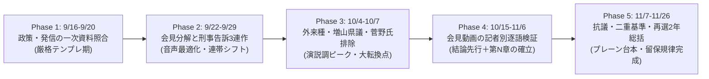

# `#兵庫クリーンラジオ` 原稿アーカイブ棚卸し＆変遷分析レポート

- **対象リポジトリ**: `https://github.com/u2tko/radio/tree/main/hyogo`
- **対象ファイル数**: 全57ファイル（配信原稿 **53本** ＋ `outline/` 配下の構成・テンプレート **4本**）
- **対象期間**: 2026年9月16日〜2026年11月26日（約2ヶ月半）
- **総文字数（空白除く）**: **214,789字**（1分350字換算で累計約10.2時間分）

> [!NOTE]
> 本レポートは、リポジトリ内の53本の原稿および4本の構成テンプレートをテキストデータとして客観的に分析したものです。各回の論点・主張は、いずれも原稿内に記述された配信者の検証対象・見解を要約・分類して整理しています。

---

## 1. 定量サマリー（月別の配信規模・傾向）

| 月 | 本数 | 総文字数 | 平均文字数 | 推定平均尺（350字/分） | 最小〜最大文字数 | 構成・書式の主な特徴 |
|---|---:|---:|---:|---:|---:|---|
| **2026年9月** | 12本 | 58,307字 | 4,859字 | 約13.9分 | 2,289〜7,018字 | 初期テンプレ準拠（風化防止1文・事実階層タグ・結論後置）。後半から音声最適化＆連帯表明へ |
| **2026年10月** | 13本 | 60,292字 | 4,638字 | 約13.3分 | 2,268〜7,847字 | 10/6〜7の演説調ピークを経て、10/15〜16で「結論先行＋第N章＋※参考資料」型を確立 |
| **2026年11月** | 28本 | 96,190字 | 3,435字 | 約9.8分 | 2,304〜4,984字 | 配信頻度が倍増（ほぼ毎日・11/8は4本連投）。全28本が「第N章＋※参考資料」に完全統一 |
| **合計** | **53本** | **214,789字** | **4,053字** | **約11.6分** | **2,268〜7,847字** | 9月→11月で **1本あたり約30%コンパクト化** し、日次継続と検証密度を両立 |

### 月別の主要キーワード出現動向（登場本数 / 延べ出現回数）

原稿内でのキーワード出現頻度を月別に見ると、**「政策・告発文書の基礎照合（9月）」→「記者会見・菅野氏排除の逐語検証（10月）」→「抗議活動・二重基準・支持者・再選2年総括（11月）」**という明確な重心移動が数値でも確認できます。

| キーワード | 2026年9月（12本） | 2026年10月（13本） | 2026年11月（28本） | 推移の読み取り |
|---|---:|---:|---:|---|
| **第三者委** | 12本 / 68回 | 6本 / 16回 | 9本 / 32回 | 9月は冒頭風化防止1文で100%登場。10月以降は必要回のみ本編で再参照 |
| **告発** | 12本 / 37回 | 5本 / 27回 | 9本 / 17回 | 同上。直接の起点から背景・比較基準へ |
| **財政 / 予算** | 7本(31) / 4本(24) | 4本(18) / 2本(6) | 3本(12) / 4本(12) | 9月前半の主軸。11月は「実務の雄弁さ」との対比軸として再登場 |
| **会見** | 9本 / 89回 | **12本 / 192回** | **26本 / 246回** | 10月以降ほぼ毎回の主戦場に。会見の一次資料検証が番組の核へ |
| **菅野 / 排除 / 記者クラブ** | 3(18) / 1(1) / 1(1) | **6(72) / 7(33) / 6(69)** | 4(48) / 4(16) / 4(18) | 10/6を起点に急浮上。11月下旬の起訴猶予・排除継続で再燃 |
| **適切** | 6本 / 45回 | **10本 / 54回** | **11本 / 102回** | 知事答弁の定型語を解剖する言語分析の代表的キーワードに定着 |
| **抗議 / 支持者 / デモ** | 4(8) / 4(10) / 0(0) | 5(25) / 3(10) / 0(0) | **16(208) / 10(81) / 4(32)** | **11月最大の急増領域**。11/4会見以降「抗議と二重基準」が中心軸に |
| **選挙 / 市長選** | 5本(21) / 0本 | **7本(48)** / 0本 | 6本(43) / 3本(11) | 高砂市県議補選（9〜10月）→ 尼崎市長選・世論調査（11月）へ連続 |

---

## 2. 論点・視点・フォーマットの変遷（5つのフェーズ）

全53本と `outline/`（[routin.md](../outline/routin.md), [template.md](../outline/template.md), [template2.md](../outline/template2.md), [20261005133532.md](../outline/20261005133532.md)）を時系列で俯瞰すると、番組は **5つの明確なフェーズ** を経て現在のスタイルへと成熟しています。

### Phase 1：個別政策・周辺発信の一次資料照合期（2026/9/16〜9/20・4本）
- **対象**: [20260916.md](../2026-09/20260916.md) 〜 [20260920.md](../2026-09/20260920.md)
- **論点**: 9月補正予算の熱中症対策、片山元副知事の補選出馬、情報公開黒塗り不備と同日の知事X、白井県議Xと県財政（起債許可団体・県立大無償化）。
- **視点・構成**: [routin.md](../outline/routin.md) の設計思想（**1回1点・風化防止1文・数字と原文が先・主張は最後40秒・事実階層タグ `［事実］` 等**）に最も忠実な時期。人格評や動機断定を厳格に排し、予算書や公式発表とSNS発信のズレを淡々と照合する「検証者」スタンス。

### Phase 2：9/16会見の徹底分解 → 「検証に基づく連帯」へのシフト期（2026/9/22〜9/29・8本）
- **対象**: [20260922.md](../2026-09/20260922.md) 〜 [20260929.md](../2026-09/20260929.md)
- **論点**: 9/16定例会見を3回に分けて検証（公益通報法・有識者意見の採否基準・漏えい指示疑惑）したのち、9/25の「知事に刑事告訴された市民3人の会見」を受け、菅野完氏・中道一政氏・難波文男氏を1人1回ずつ検証する3連作を展開。月末は奥谷県議宅前演説の再不起訴と知事の沈黙へ接続。
- **視点の変化（第1の転換点）**:
  - [20260924.md](../2026-09/20260924.md) で一時的にテンプレを外れた論評回を挟み、**[20260926.md](../2026-09/20260926.md) 以降、検証の線引きは保ちつつも「被告訴市民・被害側への明示的な連帯と抗議」へと一歩踏み込む**。
- **構成の変化**: [20260922.md](../2026-09/20260922.md) で「配信口調」へ寄せ、[20260925.md](../2026-09/20260925.md) でラジオで伝わらない記号タグ `〔〕` を廃止して音声で区分を読み上げる形式へ最適化。

### Phase 3：外来種パフォーマンス・周辺県議 → 菅野氏会見排除の緊急抗議期（2026/10/4〜10/7・5本）
- **対象**: [20261004.md](../2026-10/20261004.md) 〜 [20261007.md](../2026-10/20261007.md)
- **論点**: クビアカツヤカミキリ啓発と財政緊縮の優先順位（[20261005133532.md](../outline/20261005133532.md) の壁打ちメモとも連動）、増山誠県議の「領収書ひな型」疑惑を経て、10/6の**菅野完氏・会見出席拒否決定**を契機に論点が「報道の自由・憲法21条・検閲疑惑・記者クラブの連帯」へ急転。
- **視点・構成の変化（第2の転換点＝最大の分水嶺）**:
  - 9月期の「冒頭風化防止1文＋対象限定＋今日言えること／言えないこと」の型から完全に離脱。
  - [202610062.md](../2026-10/202610062.md)・[20261007.md](../2026-10/20261007.md) は全53本の中で最も感情的・演説的エネルギーが高い回（想定14分・約5,200〜5,600字）。この直後に番組フォーマットの再設計が起きる。

### Phase 4：会見動画の記者別・逐語解剖と「標準フォーマット」確立期（2026/10/15〜11/6・14本）
- **対象**: [20261015.md](../2026-10/20261015.md) 〜 [20261106.md](../2026-11/20261106.md)
- **論点**:
  - 10/15会見（朝日・毎日／ちだい）、10/22会見（赤澤）、10/28会見（赤澤・松本・ちだい）を**記者・媒体単位で分割し、発言を逐語引用して解剖するシリーズ手法**を確立。
  - 高砂市県議補選の片山元副知事落選（[20261027.md](../2026-10/20261027.md)）と当夜の知事X投稿（[20261028.md](../2026-10/20261028.md)）を軸に、「答弁回避の定型語」「放置による煽り」「公私線引き・広報の演出（ハロウィン仮装・週間動画・岩津ねぎ・防災庁）」を検証。
- **構成の確立（第3の転換点）**:
  - [20261015.md](../2026-10/20261015.md)〜[20261016.md](../2026-10/20261016.md) で、**①結論先行リード → ②第1章〜第N章の論理展開 → ③「おわりに」の番号付き総括 → ④末尾 `※参考資料`（動画URL・タイムスタンプ・過去回参照）**という現在の基本型が完成。演説調から「証拠を積み上げて追い詰める解説・検証調＋要所の口語ツッコミ」へ成熟。

### Phase 5：「抗議と二重基準」徹底追及・再選2年総括＆プレーン台本完成期（2026/11/7〜11/26・22本）
- **対象**: [20261107.md](../2026-11/20261107.md) 〜 [20261126.md](../2026-11/20261126.md)
- **論点**:
  - 11/4定例会見での知事による抗議活動批判を契機に、**11/8の4本連投**（[20261108.md](../2026-11/20261108.md)〜[202611084.md](../2026-11/202611084.md)）から月末まで「自分への抗議には名指し・具体論、支持者側の晒し・ヘイト・自身の過去発言には一般論・沈黙」という**非対称性（二重基準）**を集中的に検証。
  - 並行して、公務欠席（山陰近畿道3知事大会・関西広域連合防災局会議）、議会・選挙（躍動の会5人化・尼崎市長選大敗・増山県議のデモ変装潜入）、再選2年の総括（第三者委違法認定と総務省会計指摘の対比、世論調査「納得できない56.9%」、財政実務の雄弁さ vs 火種回避）、菅野氏の起訴猶予と排除継続（「法律の及ばない権力」「報道の自由」）へと議論を重層化。
- **視点・規律の完成（第4の転換点）**:
  - **フェアな前提留保の徹底**: 批判側にも不利になりうる事実や異論を先に認める論証が定着（例：菅野氏の6/3発言のライン越え承認、尼崎市長選3割を健闘とする異論への言及、第三者委報告は裁判判決でない留保、支持率15.2%→35.6%回復の承認）。
  - **一次資料・AI活用の透明化**: `※参考資料` でGrok/Threads検索の網羅性限界・動画の実物視聴確認の有無・未確認情報の不採用を明記し、11/25〜26には「Geminiとの壁打ち」で論点の核を整理した制作過程まで記録。
  - **プレーン台本化**: 11/7〜8にかけて太字・水平線・`【】` を段階的に削ぎ落とし、**約3,400字（約10分）・全4章＋おわりに4項目**の読み上げ特化フォーマットが完全定着。

---

## 3. 3つの軸で見る進化のポイント

| 比較軸 | 9月初期（`outline/routin.md` 期） | 11月中〜下旬（現行の完成期） | 変化の意味 |
|---|---|---|---|
| **テーマの射程** | 政策・予算・個別投稿の1点照合（告発文書問題は冒頭1文のみ） | 会見答弁の言語分析、報道の自由、抗議と二重基準、公務選別、選挙・世論、再選2年総括 | 単発の事実照合から、**県政運営の「行動様式・権力行使の構造」を多角的に描く連載**へ進化 |
| **論証の構造** | 事実→資料→検証→最後に結論・主張（帰納・結論後置型） | **冒頭で結論を明示**→第1〜4章で対比・裏付け→番号付き総括（演繹・結論先行型） | ラジオ聴取者が最初の30秒でテーマと主張を掴める構成へ最適化 |
| **事実と主張の分け方** | `［事実］``［公式説明］` 等の記号タグ＋「言えること／言えないこと」 | 音声自然な言い分け＋**批判側に不利な前提・異論の先出し留保**＋詳細な `※参考資料` | 形式的なラベル分けから、**論証の中身と出典管理による高い検証耐性**へ深化 |
| **制作ワークフロー** | `routin.md` の5工程（ネタ→AIツッコミ→大枠→台本→Claude整形） | 複数報道・会見書き起こし・Grok/Threads実物確認＋**Gemini壁打ち**＋過去回相互参照 | 過去の配信自体を参照可能な「番組内ナレッジベース」化が始まっている |

---

## 4. 全53本 完全棚卸し一覧

### 2026年9月（12本・計58,307字・平均4,859字）

| # | ファイル | 配信日 | タイトル（要約） | 文字数 | 主なテーマ分類 | 検証の切り口・主な論点（原稿内容の要約） |
|---:|---|---|---|---:|---|---|
| 1 | [20260916.md](../2026-09/20260916.md) | 9/16(水) | 9月補正「県立学校の熱中症対策3億円」知事発信と予算書の照合 | 4,202 | 予算・政策説明 | 補正予算案（2億9,500万円・全額国庫交付金・159校）と知事X（3億円・157校・財源未記載）のズレを「説明」の切り口で照合。 |
| 2 | [20260918.md](../2026-09/20260918.md) | 9/18(金) | 片山前副知事の補選出馬は、認定事実とどう照合するか | 4,669 | 選挙・認定対比 | 高砂補選出馬意向と百条委・両第三者委認定・不起訴処分を対比し、嫌疑不十分は行政調査認定の免罪符にならないと論じる。 |
| 3 | [20260919.md](../2026-09/20260919.md) | 9/19(土) | 情報公開の黒塗り不備と、知事Xが同日に出した説明 | 3,785 | 危機広報・SNS | 約1,000人分の個人情報漏えい公表当日に知事Xが害虫模型・予算のみ投稿した選別運用を危機広報の観点から検証。 |
| 4 | [20260920.md](../2026-09/20260920.md) | 9/20(日) | 白井県議のX投稿を検証する——「ポピュリズム」詰問は財政論の答えか | 6,099 | 県財政・県議発信 | 姫路市長の財政発言に対する白井県議の公開質問を、起債許可団体（19.2%）や県立大無償化設計と照合し論点ずらしを指摘。 |
| 5 | [20260922.md](../2026-09/20260922.md) | 9/22※ | 9月16日会見——「適切に対応した」の根拠は示されなかった | 7,018 | 会見・公益通報 | 9/16会見の松本記者5問に対する定型答弁と、用先債（前任期事案）検証との姿勢差から公益通報制度の形骸化を検証。 |
| 6 | [20260923.md](../2026-09/20260923.md) | 9/23※ | 有識者意見はいつ採用するのか――9月16日会見の説明を検証 | 4,734 | 会見・有識者採否 | 9/16会見での神戸新聞記者の問いを受け、財務検証部会と文書問題第三者委の採否基準が示されない点を検証。 |
| 7 | [20260924.md](../2026-09/20260924.md) | 9/24※ | 沖縄を超えるデマ戦が始まる——高砂補選でやるべきでないこと | 2,289 | 選挙・ネット言論 | 沖縄知事選のAIデマ事例を引き、高砂補選での女性候補・島津氏への誹謗中傷リスクに警鐘を鳴らす異例の論評回。 |
| 8 | [20260925.md](../2026-09/20260925.md) | 9/25(金) | 9月16日会見――指示の有無を問われて、返ってきたのは「認識」だけ | 5,728 | 会見・漏えい疑惑 | 9/16会見での私的情報漏えい指示疑惑4問を検証し、「認識はない」反復と片山氏への政策協力優先の姿勢を指摘（音声最適化版）。 |
| 9 | [20260926.md](../2026-09/20260926.md) | 9/26(土) | 市民への刑事告訴と、「受け入れた」という説明 | 5,251 | 刑事告訴・言論 | 9/25告訴市民側会見の菅野氏論点を検証。懲戒処分「受け入れた」発言の上書き問題を取り上げ、初めて当事者への連帯を表明。 |
| 10 | [20260927.md](../2026-09/20260927.md) | 9/27(日) | 中道氏会見を読む――告訴と公式記録、説明の使い分け | 4,512 | 刑事告訴・公文書 | 9/25会見の中道一政氏の論点（6/3会見映像削除・データ不保有・公私使い分け等）を検証し、中道氏への連帯を表明。 |
| 11 | [20260928.md](../2026-09/20260928.md) | 9/28(月) | 知事の市民告訴と、告訴された側の会見——何を説明し、していないか | 4,728 | 刑事告訴・言論 | 9/25会見の難波文男氏の論点（告訴対象の選別・削除要請なしの刑事手続）を検証し、孤立させない連帯を表明。 |
| 12 | [20260929.md](../2026-09/20260929.md) | 9/29(火) | 検察審査会は「不当」と言った。地検は再び不起訴。知事は沈黙 | 5,292 | 司法判断・選挙倫理 | 奥谷県議宅前演説をめぐる立花氏再不起訴と知事の沈黙を検証し、再不起訴への抗議と奥谷県議への連帯を頭尾で強調。 |

※9月後半のファイル名と本文内オープニング日付に1〜3日のズレがある回あり（[20260922.md](../2026-09/20260922.md)・[20260923.md](../2026-09/20260923.md)・[20260924.md](../2026-09/20260924.md)・[20260928.md](../2026-09/20260928.md)）。

### 2026年10月（13本・計60,292字・平均4,638字）

| # | ファイル | 配信日 | タイトル（要約） | 文字数 | 主なテーマ分類 | 検証の切り口・主な論点（原稿内容の要約） |
|---:|---|---|---|---:|---|---|
| 13 | [20261004.md](../2026-10/20261004.md) | 10/4(日) | 昆虫少年が知事になってしまったのか。 | 3,048 | 外来種・財政優先度 | 起債許可団体転落・カラーコピー廃止指示の下でクビアカツヤカミキリ啓発に注力する優先順位の矛盾を批判し、不信任案提出を主張。 |
| 14 | [20261005.md](../2026-10/20261005.md) | 10/5(月) | 害虫退治の陰で消えた県政 | 2,268 | 外来種・犬笛批判 | 動画・公用車シール・チラシ等の行動から財政・公益通報問題の棚上げと、支持者向け「犬笛」の懸念を論じるスピーチ型回。 |
| 15 | [20261006.md](../2026-10/20261006.md) | 10/6(火) | 増山県議の【ひな型】 | 4,362 | 県議・政治資金 | 増山誠県議の収支報告書40万円訂正「領収書ひな型」釈明の不整合と、知事の沈黙による二重基準を初めて第1〜6章構成で検証。 |
| 16 | [202610062.md](../2026-10/202610062.md) | 10/6(火・緊急) | 命の次は、言論を封殺するのか——菅野氏会見出席拒否に抗議 | 5,624 | 報道の自由・排除 | 記者クラブ復帰合意を覆す菅野氏の会見出席拒否に対し、法的根拠欠如と越権性を強く抗議し記者クラブの再考要求を評価。 |
| 17 | [20261007.md](../2026-10/20261007.md) | 10/7(水) | 菅野完氏の意見表明に大いなる賛同を——言論はまだ死んでいない | 5,184 | 報道の自由・検閲 | 菅野氏のYouTube4論点（検閲該当性・公私混濁等）を検証しつつ、10/7会見で一致団結した記者クラブ各社の追及を評価。 |
| 18 | [20261015.md](../2026-10/20261015.md) | 10/15(木) | 「取材の機会は確保している」という言葉の暴力——定例会見検証 | 7,847 | 会見逐語検証 | **標準型の起点**。10/15会見（朝日・毎日）を逐語引用し、「取材確保＝新米発表のみ」への矮小化と基準ブラックボックス化を解剖。 |
| 19 | [20261016.md](../2026-10/20261016.md) | 10/16(金) | 「共催」なのに拒否権？——ちだい記者の質疑を検証する | 6,105 | 会見逐語検証 | 10/15会見のちだい氏6問（共催・拒否権・訴訟費用・PR動画・市場金利）への「適宜適切」「注視」等の実質無回答を逐語検証。 |
| 20 | [20261025.md](../2026-10/20261025.md) | 10/25(日) | 「平穏な気持ちで退出」——答えないまま終わらせる会見を検証 | 4,391 | 会見逐語検証 | 10/22会見の赤澤記者質疑（途中打ち切り・アンガーマネジメント・幹事社4社申入）に対する「平穏」レトリックのすり替えを分析。 |
| 21 | [20261027.md](../2026-10/20261027.md) | 10/27(火) | 「俺、全部見てもうたんや」は通用しなかった——高砂県議補選検証 | 4,429 | 地方選挙分析 | 高砂補選での島津氏大勝・片山氏落選（5,454票差）を低投票率29.23%の留保付きで分析し、公用PC発言とSNS空中戦の限界を指摘。 |
| 22 | [20261028.md](../2026-10/20261028.md) | 10/28(水) | 「気分爽快、平穏な心持ち」——敗れた側近の夜に冷血と煽りを検証 | 4,651 | SNS・統治姿勢 | 片山氏落選当夜のX投稿、竹内元県議中傷への一般論、井ノ本元部長発言、元局長「わいせつ文書」レッテルの4事例を横断検証。 |
| 23 | [20261029.md](../2026-10/20261029.md) | 10/29(木) | 「答えないのに仕切る、途中で退出する」——司会者気取りの知事 | 4,111 | 会見逐語検証 | 10/28会見3部作①（赤澤記者）。答弁者がかぶせ発言で進行を仕切り質問途中で退出した二重基準と、聞く権利の侵害を検証。 |
| 24 | [202610292.md](../2026-10/202610292.md) | 10/29(木・2) | 「適宜」と「真摯」で逃げる知事——寄付者の集いはファンミか | 4,542 | 会見逐語検証 | 10/28会見3部作②（松本記者等）。寄付者「感謝の集い」の公平性、第三者委を「適宜」と言い換える言葉遊び、片山発言放置を検証。 |
| 25 | [20261031.md](../2026-10/20261031.md) | 10/31(土) | 「菅野さんが50万円出したら会えますか」——セコさと選別答弁 | 3,730 | 会見逐語検証 | 10/28会見3部作③（ちだい記者）。50万円寄付制度と菅野氏排除の矛盾、答えやすいセキュリティ実績のみ答える選別答弁を検証。 |

### 2026年11月（28本・計96,190字・平均3,435字）

| # | ファイル | 配信日 | タイトル（要約） | 文字数 | 主なテーマ分類 | 検証の切り口・主な論点（原稿内容の要約） |
|---:|---|---|---|---:|---|---|
| 26 | [20261101.md](../2026-11/20261101.md) | 11/1(日) | 自分の選挙では応援を受けて片山氏には知らん顔——公務優先の薄情 | 3,317 | 選挙・政治姿勢 | 片山氏不応援の「公務優先」答弁を、2021年・2024年知事選での応援受入れ実績と対比し原則論の使い分けを指摘。 |
| 27 | [20261102.md](../2026-11/20261102.md) | 11/2(月) | 「テニス元彦、再び」——ハロウィンのコスプレ再演と公務か私用か | 3,317 | 公私線引き・広報 | 10/31ハロウィン仮装街歩きを5月神戸まつり批判と対照し、警備・公費・公式X発信の公私線引きと知事主役化PRを検証。 |
| 28 | [20261103.md](../2026-11/20261103.md) | 11/3(火) | 「逃げた会見も『今週のまとめ』に」——切り取られた質疑とランチ | 3,162 | SNS編集・広報 | 週間まとめ動画（1分56秒）を秒数分析し、10/28会見は冒頭4秒のみ・質疑退席0秒・ランチ13秒という都合よい編集を批判。 |
| 29 | [20261104.md](../2026-11/20261104.md) | 11/4(水) | 「『おるよ』という連絡」——知事の出没情報は誰のものか | 4,004 | 情報管理・疑惑 | 支持者の「おるよって連絡」投稿を起点に、未確認仮定と留保した上で非公開動静流通が実在する場合の4つの問題点を検証。 |
| 30 | [20261105.md](../2026-11/20261105.md) | 11/5(木) | 「着実に進めてまいります」——中身のない防災庁発足ポスト | 2,700 | 防災・言行一致 | 防災庁発足X投稿に県の具体策がなく県民への備蓄要請のみである点を、1月ぼうさい甲子園遅刻・住まい初動問題と接続。 |
| 31 | [20261106.md](../2026-11/20261106.md) | 11/6(金) | 「岩津ねぎと、知事のブランド化」——市の成果と単語だけの県政 | 2,509 | 広報・農政視察 | 朝来市視察投稿を分析し、実質成果は市独自制度にあるのに県は抽象決意の単語列挙にとどまる「他者成果＋抽象決意」の型を抽出。 |
| 32 | [20261107.md](../2026-11/20261107.md) | 11/7(土) | 「抗議者を『敵』にした日」——「社会通念」を語る知事へ | 4,047 | 抗議活動・会見 | **11月の大転換点**。11/4会見での抗議批判・フランス暴動言及を検証し、SNS言論と街頭抗議の線引き・原因無視を批判。 |
| 33 | [20261108.md](../2026-11/20261108.md) | 11/8(日・1) | 「私も完璧な人間ではない」——誰も完璧を求めていない | 2,621 | 答弁戦術・言語 | 百条委から2026年6月会見まで反復される「完璧／全能ではない」発言が、具体的事実確認を人間一般論へすり替える構造を解剖。 |
| 34 | [202611082.md](../2026-11/202611082.md) | 11/8(日・2) | 「同様だと思います」の正体——身内の晒しには一般論、抗議には敵意 | 3,346 | 二重基準・抗議 | 10/22会見と11/4会見を並置し、支持者による対抗候補関係先晒しへの一般論と自分への抗議への敵意という「平穏」の非対称性を検証。 |
| 35 | [202611083.md](../2026-11/202611083.md) | 11/8(日・3) | 「真摯に受け止め、適法に抗議します」——知事の言葉をお借りして | 2,304 | 抗議・憲法権利 | 「社会通念」批判に対し知事の常套句を借りて返す提案型論考。抗議の基準は主観的社会通念ではなく憲法・法律（適法性）と主張。 |
| 36 | [202611084.md](../2026-11/202611084.md) | 11/8(日・4) | 「平穏を語るなら、ヘイトスピーチにこそ」——抗議だけが見える知事 | 2,489 | 人権・二重基準 | 県庁前での支持者側ヘイトスピーチと部落解放同盟申し入れへの一般論回答を対比し、沈黙が黙認メッセージになる問題を指摘。 |
| 37 | [20261109.md](../2026-11/20261109.md) | 11/9(月) | 「3知事の大会に、来なかった知事」——要望の場よりワクチン投稿 | 4,984 | 公務優先・対面回避 | 東京での山陰近畿道3知事大会を欠席し神戸でワクチン投稿した事実を、国会議員懇談会中止方針等と接続し「対面回避」構造を分析。 |
| 38 | [20261110.md](../2026-11/20261110.md) | 11/10(火) | 「グループライン疑惑」——「連絡いただいた」の、その先 | 3,537 | 情報管理・疑惑 | 活動家の切り抜き動画（未立証の推測と明示）を11/1投稿と接続し、会見での「答え方そのもの」が説明責任の試金石になると論じる。 |
| 39 | [20261111.md](../2026-11/20261111.md) | 11/11(水) | 「悪い人に見えない」の怖さ——お辞儀と「〇〇様」が覆い隠すもの | 2,952 | 所作・犬笛構造 | 駅立ちお辞儀の印象演出と、会見での記者固有名連呼（「〇〇様」）が誠実さ演出と質問者標的化（犬笛）を兼ねる危うさを分析。 |
| 40 | [20261112.md](../2026-11/20261112.md) | 11/12(木) | 「十五円五十銭と言ってみろ」——県庁前と、知事の沈黙 | 3,479 | 人権・ヘイト | 11/6県庁前での歴史的差別発言動画を実物確認の上、部落解放同盟申し入れ未回答と接続し知事の「差別を許さない」一言の不在を批判。 |
| 41 | [20261113.md](../2026-11/20261113.md) | 11/13(金) | 「数は力」と言ってのける——5人になったら、知事が出てきた | 3,792 | 議会対応・財政 | 躍動の会5人化の知事対応格上げと丸尾県議96項目（副知事対応）を対比し、起債許可団体下の公用車3台・ダミー運行指摘も検証。 |
| 42 | [20261114.md](../2026-11/20261114.md) | 11/14(土) | 「ご配慮を」と名指しで語る——自分への抗議にだけ具体的な知事 | 3,749 | 会見運営・二重基準 | 11/12会見で公用車抗議を具体的に批判しつつ震災復興残存負担1兆円超の質疑を11回切り上げた対比から、非対称性を検証。 |
| 43 | [20261115.md](../2026-11/20261115.md) | 11/15(日) | 終わったはずの処分を、知事が覆した——菅野完氏の会見排除 | 4,120 | 報道の自由・権力 | 記者クラブ自粛処分・復帰決定を県が覆し「法令に基づかない判断」で解除条件なく排除し続ける手続き上の権力濫用を検証。 |
| 44 | [20261116.md](../2026-11/20261116.md) | 11/16(月) | 「適切」は自分のためにある——言えない言葉と言い続ける言葉 | 3,613 | 答弁戦術・言語 | 11/4公式会見録をもとに、自己行為には「適切」を連発しつつ第三者委調査には「適切」と言わない言葉の使い分けを検証。 |
| 45 | [20261117.md](../2026-11/20261117.md) | 11/17(火) | 「社会の共感は得られない」のは誰か——尼崎市長選と応援団 | 3,341 | 選挙分析・求心力 | 11/15尼崎市長選での福永活也氏大敗（4万票超差・約30%）を高砂に続く2連敗として分析し、SNS声量と得票の落差を指摘。 |
| 46 | [20261118.md](../2026-11/20261118.md) | 11/18(水) | 「思いを傷つける」と言う資格——自分への抗議にだけ口を開く | 3,147 | 抗議・二重基準 | 神戸マラソンでの抗議苦言を、不都合案件への言及拒否および元局長への未謝罪と対比し、「思いを傷つける」と語る資格を問う。 |
| 47 | [20261120.md](../2026-11/20261120.md) | 11/20(金) | 変装して「自分のデモ」に潜入した県議——抗議を茶化す者の資格 | 3,249 | 周辺県議・抗議 | 西宮市デモに増山誠県議が変装潜入・動画配信した件を検証し、市民の異議申し立てを娯楽化・隠撮威圧する行為を批判。 |
| 48 | [20261121.md](../2026-11/20261121.md) | 11/21(土) | 「適切」の一言で過ぎた2年——自分で設置した委員会の違法認定 | 3,528 | 再選2年・説明責任 | 再選2年目の11/18会見で、総務省指摘の会計処理には「検証・再発防止」を語りつつ第三者委違法認定には「適切」で答えない選別を検証。 |
| 49 | [20261122.md](../2026-11/20261122.md) | 11/22(日) | 「積極的に働きかける」と言った17日後に——防災局の会議欠席 | 3,790 | 防災・公務欠席 | 防災局誘致宣言の17日後に広域防災担当の知事が関西広域連合委員会を欠席した落差を、過去の震災犠牲者数誤認発言等と対比。 |
| 50 | [20261123.md](../2026-11/20261123.md) | 11/23(月) | 消えた法廷——起訴猶予の裏で問われなかった「発言の原因」 | 3,540 | 司法判断・菅野氏 | 11/20の菅野氏ら3人への侮辱罪認定・起訴猶予を分析。発言のライン越えを押さえつつ、発端の「受け入れた」発言が法廷で問われなくなった構図を検証。 |
| 51 | [20261124.md](../2026-11/20261124.md) | 11/24(火) | 「決着した」と言っているのは誰か——「納得できない」56.9% | 3,016 | 世論調査・総括 | 神戸新聞・JX通信社世論調査（支持35.6%・不支持48.6%・納得できない56.9%）を分析。回復推移を認めつつ「3割台の天井」と未納得の重みを指摘。 |
| 52 | [20261125.md](../2026-11/20261125.md) | 11/25(水) | 「やり方ですね」——原因を問われて火種に触れない知事 | 4,020 | 再選2年・答弁戦術 | 11/18会見と各社インタビューを接続し、財政再建（350億円見直し）の雄弁さと抗議原因・出直し選の「火種回避」の使い分けを分析。 |
| 53 | [20261126.md](../2026-11/20261126.md) | 11/26(木) | 「誹謗中傷は誰しもすべきではない」——その言葉をまず自分に | 4,517 | 報道の自由・二重基準 | 起訴猶予後の11/25会見での排除継続、再犯防止計画との矛盾、「嘘八百」未撤回を検証し、全国レベルの報道の自由の課題として提起。 |

---

## 5. 棚卸しから見えた「運用・制作上の発見」と次の一手

全53本と `outline/` を突き合わせると、原稿資産をさらに活かすための具体的な改善・活用ポイントが4点浮かび上がります。

1. **`outline/` テンプレートと現行スタイルの乖離を最新化できる**
   - `outline/` の [routin.md](../outline/routin.md) や [template.md](../outline/template.md) は**9月初期の「政策1点・結論後置・冒頭風化防止1文」型**のまま残っています。
   - 一方で実際の配信は11月時点で、**「結論先行リード＋全4章＋おわりに4項目＋留保規律付き※参考資料（約3,400字・10分）」**へと大きく進化しています。この完成形を Antigravity のプロジェクト専用ルール（`.agents/rules/`）やスキルに落とし込むと、今後の制作・壁打ちが一気に再現性高く回せます。
2. **「番組内ナレッジベース（過去回リンク辞書）」が作れる**
   - 11月の原稿ではすでに「20261115（本配信の過去回）」のような相互参照が始まっています。全53本をトピック別・発言別（「適切」「平穏」「社会通念」「菅野氏排除」「防災」「起債許可団体」など）に索引化しておけば、新ネタが出た際に「過去にいつ・何を検証したか」を即座に引けるようになります。
3. **テーマの偏り・手薄領域（未回収テーマ）の可視化ができる**
   - 11月は「抗議・二重基準・会見運営・報道の自由」が非常に濃密な一方、9月初期に掲げていた**「予算・事業・実績値・議会答弁（政策そのものの検証）」**の比重は下がっています（例：9月補正の熱中症対策備品のその後の入札・納品実績、起債許可団体「公債費負担適正化計画」の具体的削減対象、350億円見直しの中身など）。
4. **細かなアーカイブ整備（メタデータ統一）の余地**
   - 9月後半の4ファイルに「ファイル名の日付」と「本文オープニングの日付」のズレ、一部ファイルに軽微な誤字・重複（例：[20260922.md](../2026-09/20260922.md) の「台台本」、[20260929.md](../2026-09/20260929.md) の「二つ目」欠番、[20261016.md](../2026-10/20261016.md) の「仮定／家庭」表記揺れ）があります。アーカイブ公開・再利用するなら一括チェックも可能です。
